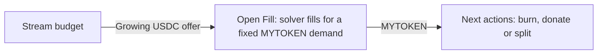

# Open Fill

Open Fill exchanges its input for a fixed amount of another token, then passes the output to child actions. Combine it with a [Stream budget](../budgets/stream.md) for a growing offer, as in the [recurring buyback example](../examples/buyback.md).

## Core concepts

- **Offer:** the node's full input allocation, available for the solver to spend.
- **Demand:** `demandPerFill`, the minimum amount of `demandedToken` the `DAO.sol` contract must receive.
- **Solver:** the contract that triggers the flow and completes the exchange when called back by the `DAO.sol` contract.



## Choose the auction terms

Set the output token and demand in a [recipe node](../../../guides/compose-capital-tree.md#build-a-custom-recipe). Here `node` is a `Setup.RecipeNode` and `myToken` is an [`IERC20`](../budgets/index.md#the-budget-interface) reference with 18 decimals:

```solidity
node.action.id = bytes32("OpenFillAction@1");
node.action.settings = abi.encode(myToken, uint256(100e18));
```

The demand must be positive and the demanded token must differ from the budget token. Setup supplies the flow's [checkpointed budget](../budgets/stream.md#checkpoint-interface) as a dependency.

The maximum offer comes from the budget and any upstream split. For a root action, the stream's `maxBudget` bounds it. See [buyback pricing](../examples/buyback.md#how-solvers-compete-on-price) for choosing the demand, rate and cap together.

## Action interface and execution

Open Fill implements [INodeAction](index.md#the-node-action-interface):

1. `build()` returns the demanded output and three calls: approve the solver, call its exchange callback, then clear approval.
2. `preconditions()` records the treasury's input- and output-token balances.
3. After the `DAO.sol` contract executes the calls, `postconditions()` checks that at least the demand arrived and at most the offer was spent. Failure reverts the flow.

Children receive the declared demand. Enable [`forwardSurplus`](../execution.md#inputs-and-outputs) to send all received output through later steps.

## Change demand or placement

Calling `setDemandPerFill` requires `SET_SETTINGS_PERMISSION_ID` on the action and restarts the whole budget from zero. Setup grants the action `CHECKPOINT_PERMISSION_ID` on its budget for this purpose.

Open Fill can sit below an action or splitter. The whole flow waits for a successful fill; use separate flows for branches needing independent schedules.

## Solvers

See [Build and run a Capital Tree solver](../examples/buyback/openfill.md) for the callback interface, trigger data and supplied `GenericFillSolver`.

## See also

- [Recurring buybacks](../examples/buyback.md): the auction mechanism and a complete recipe.
- [All actions](index.md) and [Execution](../execution.md).
- [Contract source](https://github.com/aragon/capital-tree/blob/47eb5ef56e8f83822d832e23da49dc76b103d37c/src/actions/OpenFillAction.sol) and [settings metadata](https://github.com/aragon/capital-tree/blob/47eb5ef56e8f83822d832e23da49dc76b103d37c/metadata/components/OpenFillAction.json).
