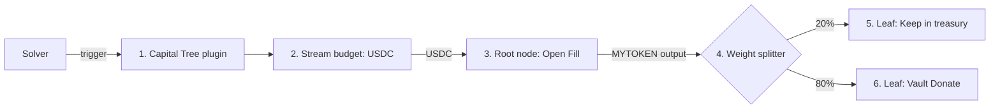

# Capital Tree concepts

These concepts describe how a [Capital Tree](../capital-tree.md) flow is structured and run.

## A trigger runs the flow

A **trigger** is one call to the plugin's `trigger(budgetData, nodeData)` function to run the flow. Its **caller** is the account or contract making that call.

A trigger supplies two kinds of optional input: **budget data** for calculating availability or proving entitlement, and **node data** for individual actions. The same caller identity reaches the budget and every action. The [execution lifecycle](execution.md#one-transaction) runs the tree and records completion in one transaction; failure rolls back the whole run.

## A budget supplies the flow

The [budget](budgets/index.md) selects an ERC20 token to start the flow and determines how much is available when triggered. Any ERC20 can be the input token; the examples use USDC. An **allocation** is a token and an amount available to a node. The budget supplies the first allocation to the **root**, node 0.

## Nodes define the structure

A **node** is a position in the tree. A **parent** supplies an allocation to its **children**, the nodes directly below it. A node receives its allocation from the budget or its parent and can have an [action](actions/index.md). The action builds calls for the `DAO.sol` contract to execute and checks their result. Its output becomes the allocation available to the node's children.

A node can also branch without an action: it passes its input to its children through a splitter.

## Splitters divide allocations

A [splitter](splitters/index.md) is needed when a node has two or more children. It divides the node's output between them in their configured order. With one child, the whole output passes to that child without a splitter.

## Leaves complete the flow

A **leaf** is a node without children. Its action completes that branch: for example, by transferring, burning, donating or retaining its allocation. A leaf declares no output for further nodes. Keeping an allocation is an explicit action, as the retention branch in the [example below](#example-swap-retain-and-donate) illustrates.

## New trees compose new flows

Combine the same budgets, actions and splitters into different trees to create new capital flows. A **component** is a budget, action or splitter implementation. The **registry** maps component IDs to implementations and their configuration metadata. A **recipe** selects these components and declares their settings, connections and permissions. When existing components provide the behavior you need, a new flow needs only a new composition, not new component contracts.

See [composing new flows](../../guides/compose-capital-tree.md) for the recipe pattern, and [Execution](execution.md) for how a tree runs and its allocations are checked.

## Example: swap, retain and donate

In this example, a protocol runs a token buyback using USDC to purchase MYTOKEN through a progressive auction: the USDC offered grows over time until a **solver**—a contract that executes the exchange—fills the order. Purchased tokens are split: 20% is retained by the treasury and 80% is donated to a staking vault to benefit existing stakers.

The [recipe](../../guides/compose-capital-tree.md) selects registered budget, action and splitter components, configures their settings, and connects them into the tree below.

1. **Trigger the flow.** The solver calls `trigger()` on the Capital Tree plugin to start the buyback.
2. **Read the budget.** The [Stream budget](budgets/stream.md) determines how much USDC is available.
3. **Buy MYTOKEN.** The solver exchanges USDC for MYTOKEN through the [Open Fill action](actions/open-fill.md).
4. **Split the purchased tokens.** The [Weight Splitter](splitters/weight.md) directs 20% to retention and 80% to donation.
5. **Retain 20%.** [Keep](actions/keep.md) leaves these tokens in the treasury.
6. **Donate 80%.** [Vault Donate](actions/vault-donate.md) sends the rest to the staking vault to benefit existing stakers.

**Component source:** [CapitalTreePlugin.sol](https://github.com/aragon/capital-tree/blob/47eb5ef56e8f83822d832e23da49dc76b103d37c/src/CapitalTreePlugin.sol) · [StreamBudget.sol](https://github.com/aragon/capital-tree/blob/47eb5ef56e8f83822d832e23da49dc76b103d37c/src/budgets/StreamBudget.sol) · [OpenFillAction.sol](https://github.com/aragon/capital-tree/blob/47eb5ef56e8f83822d832e23da49dc76b103d37c/src/actions/OpenFillAction.sol) · [WeightSplitter.sol](https://github.com/aragon/capital-tree/blob/47eb5ef56e8f83822d832e23da49dc76b103d37c/src/splitters/WeightSplitter.sol) · [KeepAction.sol](https://github.com/aragon/capital-tree/blob/47eb5ef56e8f83822d832e23da49dc76b103d37c/src/actions/KeepAction.sol) · [VaultDonateAction.sol](https://github.com/aragon/capital-tree/blob/47eb5ef56e8f83822d832e23da49dc76b103d37c/src/actions/VaultDonateAction.sol).
