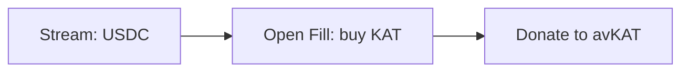

# Buyback and Donate: avKAT

Use a [recurring buyback](buyback.md) to buy KAT with treasury USDC and donate purchased tokens to the avKAT staking vault. The donation benefits existing stakers; the `DAO.sol` contract receives no avKAT shares.

## Choose the terms

Set the [Stream](../budgets/stream.md) rate and cap, the KAT demand for [Open Fill](../actions/open-fill.md), and the vault. The cap limits the USDC offered per fill. Choose amounts in raw units: USDC uses six decimals and KAT uses eighteen.

## Where the proceeds go

This recipe enables [`forwardSurplus`](../execution.md#inputs-and-outputs), making KAT received above the demand available to subsequent actions. Pre-existing treasury KAT and unspent USDC stay in the treasury.

The vault must support [Vault Donate](../actions/vault-donate.md). If a swap or donation fails, the whole run rolls back. A paused vault therefore blocks this flow.

## Configure and operate

Use [`Recipes.buybackAndDonate`](https://github.com/aragon/capital-tree/blob/47eb5ef56e8f83822d832e23da49dc76b103d37c/script/Recipes.sol) and the [configuration example](https://github.com/aragon/capital-tree/blob/47eb5ef56e8f83822d832e23da49dc76b103d37c/config/buyback-and-donate.example.json). Review the complete configuration, replace placeholder addresses and choose your auction terms; the example amounts are illustrative.

Follow [Setup and permissions](../setup.md#the-install-proposal) to install the flow. Revenue goes to the `DAO.sol` contract; [sync the stream](../budgets/stream.md#operate-the-stream) after funding it. The registry must include `VaultDonateAction@1` before preparing this recipe.

Deployment and fork reproduction stay in the [repository runbook](https://github.com/aragon/capital-tree/blob/47eb5ef56e8f83822d832e23da49dc76b103d37c/docs/avkat-buyback.md#reproduce).

**Component source:** [StreamBudget.sol](https://github.com/aragon/capital-tree/blob/47eb5ef56e8f83822d832e23da49dc76b103d37c/src/budgets/StreamBudget.sol) · [OpenFillAction.sol](https://github.com/aragon/capital-tree/blob/47eb5ef56e8f83822d832e23da49dc76b103d37c/src/actions/OpenFillAction.sol) · [VaultDonateAction.sol](https://github.com/aragon/capital-tree/blob/47eb5ef56e8f83822d832e23da49dc76b103d37c/src/actions/VaultDonateAction.sol).

[All examples](index.md).
