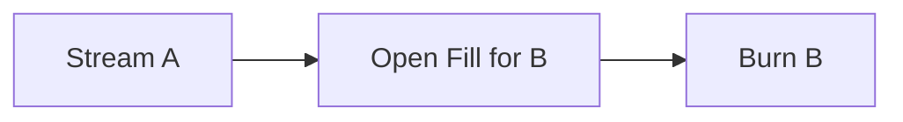

# Buy and Burn

Spend streamed token A to acquire and burn token B.

Use a [Stream budget](../budgets/stream.md), [Open Fill](../actions/open-fill.md) and [Burn](../actions/burn.md). The demanded token must implement `burn(uint256)`.

Start with [Run a recurring buyback](buyback.md) for the auction mechanism, solver competition and a complete recipe. This variant burns the purchased tokens.

The supplied recipe burns the declared demand. It leaves [`forwardSurplus`](../execution.md#inputs-and-outputs) false, so extra B stays in the `DAO.sol` contract. To burn surplus too, explicitly enable forwarding on the Open Fill node in a custom recipe. A failed burn rolls back the fill and checkpoint.

## Configure and install

Use [`Recipes.buyAndBurn`](https://github.com/aragon/capital-tree/blob/47eb5ef56e8f83822d832e23da49dc76b103d37c/script/Recipes.sol) and the [configuration example](https://github.com/aragon/capital-tree/blob/47eb5ef56e8f83822d832e23da49dc76b103d37c/config/buy-and-burn.example.json). Follow [setup and permissions](../setup.md#the-install-proposal) to install the flow. Replace addresses and choose amounts in each token's smallest unit.

**Component source:** [StreamBudget.sol](https://github.com/aragon/capital-tree/blob/47eb5ef56e8f83822d832e23da49dc76b103d37c/src/budgets/StreamBudget.sol) · [OpenFillAction.sol](https://github.com/aragon/capital-tree/blob/47eb5ef56e8f83822d832e23da49dc76b103d37c/src/actions/OpenFillAction.sol) · [BurnAction.sol](https://github.com/aragon/capital-tree/blob/47eb5ef56e8f83822d832e23da49dc76b103d37c/src/actions/BurnAction.sol).

[All examples](./index.md).
