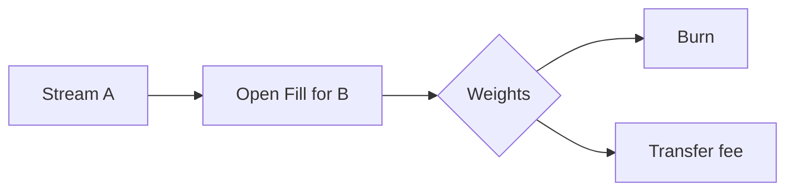

# Buyback with a Fee

Extend a [recurring buyback](buyback.md) to burn a share of the purchased token and transfer the rest to a fixed fee recipient.

Combine [Stream](../budgets/stream.md), [Open Fill](../actions/open-fill.md), [Weight Splitter](../splitters/weight.md), [Burn](../actions/burn.md) and [Transfer](../actions/transfer.md).

[`Recipes.buyback`](https://github.com/aragon/capital-tree/blob/47eb5ef56e8f83822d832e23da49dc76b103d37c/script/Recipes.sol) takes a fee weight in [millionths](../splitters/weight.md): 50,000 means 5%. Children are ordered burn first, fee second; weights are 950,000 and 50,000. A declared output of 1,000 [raw units](../budgets/index.md#core-concepts) therefore burns 950 and pays 50.

Both weights must be positive. Choose a demand large enough that the fee does not round to zero; supplied nodes are not skippable. Surplus above the demand stays in the `DAO.sol` contract because this recipe does not enable forwarding. The [manager](../setup.md#roles-and-permissions) may update weights; replacing the fixed fee recipient requires a new action and a flow update.

## Configure and install

Use `Recipes.buyback` and the [configuration example](https://github.com/aragon/capital-tree/blob/47eb5ef56e8f83822d832e23da49dc76b103d37c/config/buyback.example.json). Follow [setup and permissions](../setup.md#the-install-proposal) to install the flow. Replace addresses and choose amounts in each token's smallest unit.

**Component source:** [StreamBudget.sol](https://github.com/aragon/capital-tree/blob/47eb5ef56e8f83822d832e23da49dc76b103d37c/src/budgets/StreamBudget.sol) · [OpenFillAction.sol](https://github.com/aragon/capital-tree/blob/47eb5ef56e8f83822d832e23da49dc76b103d37c/src/actions/OpenFillAction.sol) · [WeightSplitter.sol](https://github.com/aragon/capital-tree/blob/47eb5ef56e8f83822d832e23da49dc76b103d37c/src/splitters/WeightSplitter.sol) · [BurnAction.sol](https://github.com/aragon/capital-tree/blob/47eb5ef56e8f83822d832e23da49dc76b103d37c/src/actions/BurnAction.sol) · [TransferAction.sol](https://github.com/aragon/capital-tree/blob/47eb5ef56e8f83822d832e23da49dc76b103d37c/src/actions/TransferAction.sol).

[All examples](./index.md).
