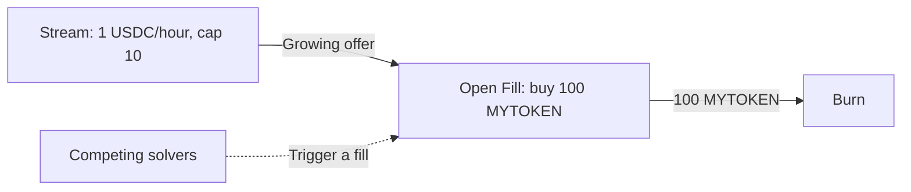
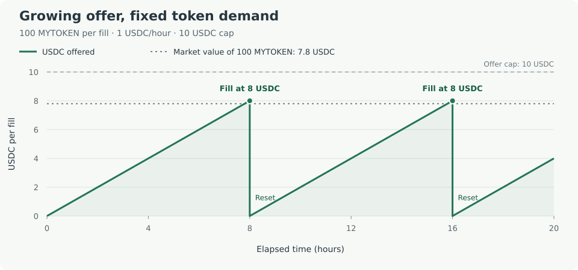

# Run a recurring buyback

Combine a [Stream budget](../budgets/stream.md) with [Open Fill](../actions/open-fill.md) to buy your protocol's token repeatedly. Stream increases the amount offered; Open Fill fixes the amount to buy. Solvers compete to complete the exchange as the offer becomes profitable, and the tree decides what happens to the purchased tokens.

This example buys and burns 100 MYTOKEN per run, offering USDC that grows by 1 per hour up to a cap of 10.



## How solvers compete on price

The offer starts at zero and rises against a fixed token demand: a **Dutch auction**. A solver compares the USDC offered with the cost of sourcing 100 MYTOKEN and executing the transaction.



Here the illustrative market price is 0.078 USDC per MYTOKEN: 7.8 USDC for the fixed demand of 100. A solver filling at 8 USDC has 0.2 USDC to cover execution costs and margin. Each completed fill resets the offer to zero.

A solver that needs 9 USDC would have to wait longer. Waiting for a larger offer risks another solver filling first, encouraging earlier execution at a better buyback price. Explore the growing offer and market price in the [interactive demo](https://capital-router-demo.aragon.org/).

The **rate** controls how quickly the offer grows, the **demand** sets the purchase size, and the **cap** sets the maximum spend per fill. Here the cap limits the price to 0.10 USDC per MYTOKEN. At the cap, the offer stops growing and waits for a fill. Pricing depends on participating solvers and available liquidity; the contract enforces the cap and demand.

## Build the recipe

Use [`Recipes.buyAndBurn`](https://github.com/aragon/capital-tree/blob/47eb5ef56e8f83822d832e23da49dc76b103d37c/script/Recipes.sol). In this builder excerpt, `usdc` and `myToken` are `IERC20` references; MYTOKEN has 18 decimals. `manager` and `guardian` are the chosen [role holders](../setup.md#roles-and-permissions), and `Setup` refers to [`CapitalTreePluginSetup`](https://github.com/aragon/capital-tree/blob/47eb5ef56e8f83822d832e23da49dc76b103d37c/src/setup/CapitalTreePluginSetup.sol).

```solidity
Recipes.Stream memory stream = Recipes.Stream({
    token: usdc,
    amountPerEpoch: 1_000_000, // 1 USDC
    maxBudget: 10_000_000,    // 10 USDC
    epochInterval: 1 hours
});
Recipes.Swap memory swap = Recipes.Swap({
    demandedToken: myToken,
    demandPerFill: 100e18     // 100 MYTOKEN
});
Setup.InstallParams memory recipe =
    Recipes.buyAndBurn(manager, guardian, stream, swap);
```

MYTOKEN must support `burn(uint256)`. Follow [Setup and permissions](../setup.md#the-install-proposal) and the repository's [configuration example](https://github.com/aragon/capital-tree/blob/47eb5ef56e8f83822d832e23da49dc76b103d37c/config/buy-and-burn.example.json) to install it, then [fund and sync the stream](../budgets/stream.md#operate-the-stream).

## Run each buyback

1. **Watch the offer.** Solver operators monitor availability and source a route for MYTOKEN. The supplied recipe grants `TRIGGER_PERMISSION_ID` to `ANY_ADDR`, allowing any compatible solver to fill.
2. **Fill and burn.** A solver triggers the plugin. The `DAO.sol` contract executes the exchange and burns the demanded tokens; a failure rolls back the whole run.
3. **Restart.** The completed flow checkpoints the stream to zero. With funding available, the next offer begins growing immediately.

Use the [solver integration guide](./buyback/openfill.md) to implement or operate a solver. Change the final steps to [donate to a staking vault](avkat-buyback.md) or [retain and donate](../../../guides/compose-capital-tree.md). The [Buy and Burn](buy-and-burn.md) variant explains surplus handling.

**Component source:** [StreamBudget.sol](https://github.com/aragon/capital-tree/blob/47eb5ef56e8f83822d832e23da49dc76b103d37c/src/budgets/StreamBudget.sol) · [OpenFillAction.sol](https://github.com/aragon/capital-tree/blob/47eb5ef56e8f83822d832e23da49dc76b103d37c/src/actions/OpenFillAction.sol) · [BurnAction.sol](https://github.com/aragon/capital-tree/blob/47eb5ef56e8f83822d832e23da49dc76b103d37c/src/actions/BurnAction.sol).

[All examples](index.md).
