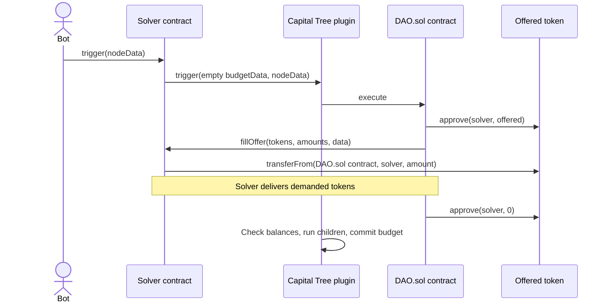

# Build and run a Capital Tree solver

A solver combines a bot that finds profitable fills with a contract that completes the exchange. This guide uses a [Stream budget](../../budgets/stream.md) feeding [Open Fill](../../actions/open-fill.md) at node 0, followed by the buyback's burn, transfer or donation actions. See [recurring buybacks](../buyback.md) for how growing offers encourage competition between solvers.

## Connect to the buyback

Use the **Capital Tree plugin address installed for the buyback you want to fill** as `pluginAddress`. Deploy [`GenericFillSolver`](https://github.com/aragon/capital-tree/blob/47eb5ef56e8f83822d832e23da49dc76b103d37c/src/solvers/GenericFillSolver.sol) with `new GenericFillSolver(operator, CapitalTreePlugin(pluginAddress))`, where `operator` is the account running your bot.

The **solver contract address** needs `TRIGGER_PERMISSION_ID` on that Capital Tree plugin, or the permission must be granted to `ANY_ADDR` to allow any solver. Read the plugin's budget and Open Fill action using the [offer queries below](#read-the-offer). To configure your own buyback, see [Open Fill](../../actions/open-fill.md) and [Setup](../../setup.md).

## Contract and callback

Your contract calls the plugin's `trigger()`; the `DAO.sol` contract then calls it back through [`IFiller`](https://github.com/aragon/capital-tree/blob/47eb5ef56e8f83822d832e23da49dc76b103d37c/src/interfaces/IFiller.sol). This **callback** lets the solver collect the offered tokens and deliver the demanded tokens within the same transaction. Token parameters use [`IERC20`](../../budgets/index.md#the-budget-interface):

```solidity
interface IFiller {
    /// @notice Completes the exchange before returning to the calling contract.
    /// @dev Authenticate the calling DAO.sol contract before executing the exchange.
    /// @param offeredAmount Maximum amount the solver may pull.
    /// @param demandedAmount Minimum increase in the DAO.sol contract's demanded-token balance.
    /// @param data This Open Fill node's trigger data, passed through unchanged.
    function fillOffer(
        IERC20 offeredToken,
        uint256 offeredAmount,
        IERC20 demandedToken,
        uint256 demandedAmount,
        bytes calldata data
    ) external;
}
```

Authenticate the callback's caller as the expected `DAO.sol` contract. The plugin receives the solver contract as the trigger caller, while exchanges called inside the callback originate from the solver.

**Collect the offer with `transferFrom`.** The `DAO.sol` contract approves your solver to pull up to `offeredAmount`; include the transfer in your callback. You may collect less, but must deliver at least `demandedAmount` more of the demanded token. Collection and delivery can happen in either order.



The [balance checks](../../execution.md#inputs-and-outputs) require full delivery and limit the offered-token spend. A failure rolls back the whole flow. Successful completion checkpoints the stream, starting the next offer from zero. Extra output follows the node's `forwardSurplus` setting, so choose amounts and recipients accordingly.

### Using [GenericFillSolver](https://github.com/aragon/capital-tree/blob/47eb5ef56e8f83822d832e23da49dc76b103d37c/src/solvers/GenericFillSolver.sol)

- The operator calls `trigger(nodeData)`; the solver supplies empty budget data.
- Only the configured `DAO.sol` contract can call `fillOffer`. It decodes the Open Fill node's data as [`Action[]`](../../../../core/execution.md) and executes that batch in order.
- Each call uses the supplied calldata. Build transfers, approvals and swaps explicitly, with `value: 0`: this executor sends no native value and does not substitute callback amounts into the batch.
- `sweep(token, recipient)` sends the solver's entire token balance to the recipient. The operator or the solver itself within a batch can call it.

Batch calls revert on EVM failure but do not decode ERC20 boolean return values; `sweep` uses `SafeERC20`. Your bot or custom solver must check profitability and the intended token movements.

## Read the offer

For a root Open Fill action, read these values from the buyback's plugin at the same block:

| Read | Purpose |
|---|---|
| `plugin.dao()` | Treasury holding the tokens |
| `plugin.nodes()` | Root action at index 0 and the number of nodes |
| `plugin.budget()` | Budget to query |
| `budget.token()` and `budget.available(solverAddress, "")` | Offered token and amount |
| `action.demandedToken()` and `action.demandPerFill()` | Required output token and amount |
| `plugin.paused()` | Whether the flow can run |

Use `available()` rather than reconstructing stream growth in the bot. An Open Fill below a splitter receives its assigned share; this example uses the full budget at the root. Use the returned `nodes` array to size the trigger data, as shown below.

## Build and submit a fill

There are three encoding layers:

1. Each `Action.data` is function calldata for a transfer, approval or swap.
2. Open Fill's payload is ABI-encoded `Action[]`, matching Solidity's `abi.encode(calls)`.
3. `nodeData` contains one entry per node, with that payload at Open Fill's index and `"0x"` for nodes needing no data.

Supply the encoded batch, not `fillOffer(...)` calldata: the action constructs the callback. `GenericFillSolver` needs an encoded `Action[]` at every Open Fill node it serves.

### Match the installed node count

`nodeData.length` must match `plugin.nodes().length` when supplying fill data. Include an entry for every node, using `"0x"` for actions that need no data. For these supplied [recipes](https://github.com/aragon/capital-tree/blob/47eb5ef56e8f83822d832e23da49dc76b103d37c/script/Recipes.sol), Open Fill is node 0:

| Example | Nodes in order | `nodeData` |
|---|---|---|
| [Buy and Burn](../buy-and-burn.md) | 0: Open Fill, 1: Burn | `[fillData, "0x"]` |
| [Katana buyback and donation](../avkat-buyback.md) | 0: Open Fill, 1: Transfer, 2: Vault Donate | `[fillData, "0x", "0x"]` |

`fillData` is the encoded `Action[]` executed by the solver. The Katana recipe's two child actions run after the fill; their recipient and vault are already configured. The splitter belongs to node 0 and adds no extra array entry.

The viem example below reads `nodes()` directly. In Solidity or a Foundry script, the equivalent is:

```solidity
uint256 nodeCount = plugin.nodes().length;
bytes[] memory nodeData = new bytes[](nodeCount);
nodeData[0] = abi.encode(calls); // calls is the solver's Action[] batch.
```

Read the installed flow each time you build a fill, so a later configuration change is reflected in the array length and node positions.

### Encode and submit with viem

The example below uses [viem](https://viem.sh/docs/contract/encodeFunctionData) and [`GenericFillSolver`](https://github.com/aragon/capital-tree/blob/47eb5ef56e8f83822d832e23da49dc76b103d37c/src/solvers/GenericFillSolver.sol). Supply the values read above, the deployed solver address as `solver`, `publicClient`, `walletClient`, and the authorized operator as `account`. Amounts are raw token units represented as `bigint`.

Obtain a swap quote with the solver as caller and output recipient, enforcing at least `demandedAmount` of output. Here `quote` is your adapter's normalized result: `sellAmount` and `value` are bigint; `allowanceTarget` is the spender; `to` and `data` specify the swap call. The spender and swap target may differ.

This batch collects the offered tokens, swaps them, and sends exactly the demanded amount to the `DAO.sol` contract. Remaining output stays with the solver for later withdrawal using `sweep`.

```javascript
import {
  encodeAbiParameters,
  encodeFunctionData,
  erc20Abi,
  parseAbi,
  parseAbiParameters,
} from "viem";

const solverAbi = parseAbi(["function trigger(bytes[] data)"]);
const pluginAbi = parseAbi([
  "function nodes() view returns ((address action, uint32[] children, address splitter, bool skipWhenEmpty, bool forwardSurplus)[])",
]);
const nodes = await publicClient.readContract({
  address: pluginAddress, // Capital Tree plugin installed for this buyback.
  abi: pluginAbi,
  functionName: "nodes",
});
const openFillIndex = 0; // Root OpenFill in this example.
const tokenCall = (token, functionName, args) => ({
  to: token,
  value: 0n,
  data: encodeFunctionData({ abi: erc20Abi, functionName, args }),
});

if (quote.value !== 0n) throw new Error("This solver cannot send ETH");
if (quote.sellAmount <= 0n || quote.sellAmount > offeredAmount) {
  throw new Error("Quoted input does not fit the offer");
}

const calls = [
  // Collect the offer using the allowance from the DAO.sol contract.
  tokenCall(offeredToken, "transferFrom", [dao, solver, quote.sellAmount]),
  tokenCall(offeredToken, "approve", [quote.allowanceTarget, 0n]),
  tokenCall(offeredToken, "approve", [quote.allowanceTarget, quote.sellAmount]),
  // The quote routes swap output to the solver.
  { to: quote.to, value: 0n, data: quote.data },
  tokenCall(offeredToken, "approve", [quote.allowanceTarget, 0n]),
  tokenCall(demandedToken, "transfer", [dao, demandedAmount]),
];

// Equivalent to Solidity's abi.encode(calls), where calls is Action[].
const actionArray = parseAbiParameters(
  "(address to, uint256 value, bytes data)[]",
);
const fillData = encodeAbiParameters(actionArray, [calls]);
const nodeData = Array(nodes.length).fill("0x");
nodeData[openFillIndex] = fillData;
// Buy and Burn: [fillData, "0x"].
// Katana: [fillData, "0x", "0x"].

const { request } = await publicClient.simulateContract({
  address: solver,
  abi: solverAbi,
  functionName: "trigger",
  args: [nodeData],
  account,
});
const hash = await walletClient.writeContract(request);
const receipt = await publicClient.waitForTransactionReceipt({ hash });
if (receipt.status !== "success") throw new Error(`Fill reverted: ${hash}`);
```

[`encodeFunctionData`](https://viem.sh/docs/contract/encodeFunctionData) supplies the function selector and arguments; [`encodeAbiParameters`](https://viem.sh/docs/abi/encodeAbiParameters) encodes the batch for `abi.decode(data, (Action[]))`.

To pay from inventory, omit the swap and router approvals. If the swap sends output directly to the `DAO.sol` contract, omit the final demanded-token transfer. In either case, collect the offer and deliver the full demand during the callback.

## Operate and troubleshoot

Read the offer, obtain a route or price your inventory, and include gas and your margin in the profitability check. [Simulate](https://viem.sh/docs/contract/simulateContract), submit, and inspect the receipt, `NodeExecuted` events and token movements. Another solver or a settings change can invalidate the quote before inclusion; re-read and rebuild after a stale attempt. For downstream nodes, check execution events because `skipWhenEmpty` may skip a branch.

Use the relevant contract ABI to decode errors; nested failures may require a trace:

| Error | What to check |
|---|---|
| `DaoUnauthorized` | Permission target, holder and ID. The trigger caller is the solver contract. |
| `Unauthorized` | The bot must be the solver's authorized operator; the callback must come from its configured `DAO.sol` contract. |
| `Pausable: paused` | Wait for the flow to resume, then refresh the offer. |
| `DataLengthMismatch` | Re-read nodes and supply one data entry per node. |
| `EmptyInput` | Budget availability and the failing node's allocation. |
| `DemandNotMet` | Output recipient and amount delivered. Error arguments are treasury balances. |
| `OfferExceeded` | Calls spending the offered token exceeded its permitted balance decrease. |
| `UnexpectedBalance` | The indicated node's input/output amounts and token behavior. |
| `BudgetExceeded` | Total budget-token spend, including downstream actions. |
| `ActionFailed` | A call from the `DAO.sol` contract failed: Open Fill indices 0/1/2 are approval/callback/cleanup. |
| `CallFailed` | The zero-based index in the solver batch; normally wrapped by `ActionFailed(1)`. |

Transfer fees, rebasing or token restrictions can affect received amounts and cause these checks to fail.

## Source and interfaces

Use the [plugin](https://github.com/aragon/capital-tree/blob/47eb5ef56e8f83822d832e23da49dc76b103d37c/src/CapitalTreePlugin.sol), [node types](https://github.com/aragon/capital-tree/blob/47eb5ef56e8f83822d832e23da49dc76b103d37c/src/lib/types.sol), [Stream budget](../../budgets/stream.md#checkpoint-interface) and [Open Fill](../../actions/open-fill.md#action-interface-and-execution) for exact types, methods and events.

The repository provides [quote helpers](https://github.com/aragon/capital-tree/blob/47eb5ef56e8f83822d832e23da49dc76b103d37c/script/open-fill/Quotes.s.sol), [local swap tests](https://github.com/aragon/capital-tree/blob/47eb5ef56e8f83822d832e23da49dc76b103d37c/test/solvers/OpenFillLocal.t.sol) and [run instructions](https://github.com/aragon/capital-tree/blob/47eb5ef56e8f83822d832e23da49dc76b103d37c/script/open-fill/README.md) for additional local and fork examples.
