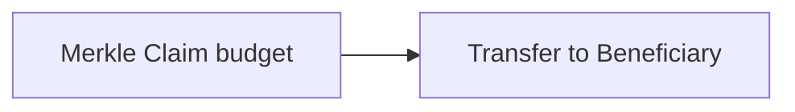

# Merkle Claims

Let each account claim its [cumulative entitlement](../budgets/merkle-claim.md) to an address it chooses.



Use [Merkle Claim](../budgets/merkle-claim.md) and [Transfer to Beneficiary](../actions/transfer-to-beneficiary.md). Fund the `DAO.sol` contract separately. Prepare a StandardMerkleTree of `(address, uint256)` values, with cumulative amounts in raw token units.

An account previously paid 40 with a new cumulative entitlement of 100 receives 60. The account itself sends the transaction to the installed plugin; a wrapper would change the caller identity.

```solidity
// Call from the entitled account. Variables refer to the installed flow
// and a proof against its current root; beneficiary is the chosen recipient.
bytes[] memory nodeData = new bytes[](1);
nodeData[0] = abi.encode(beneficiary);
plugin.trigger(abi.encode(account, cumulative, proof), nodeData);
```

The claim records only after the transfer succeeds. A repeated claim reverts with `NothingToClaim`; an invalid proof, wrong caller or underfunded transfer reverts without consuming the claim. A new root retains previous claim accounting. The [manager](../setup.md#roles-and-permissions) controls that root and therefore which accounts can spend the `DAO.sol` contract's token balance.

## Configure and install

Use [`Recipes.merkleClaim`](https://github.com/aragon/capital-tree/blob/47eb5ef56e8f83822d832e23da49dc76b103d37c/script/Recipes.sol) and the [configuration example](https://github.com/aragon/capital-tree/blob/47eb5ef56e8f83822d832e23da49dc76b103d37c/config/merkle-claim.example.json). Follow [setup and permissions](../setup.md#the-install-proposal) to install the flow. Replace addresses and choose amounts in each token's smallest unit.

**Component source:** [MerkleClaimBudget.sol](https://github.com/aragon/capital-tree/blob/47eb5ef56e8f83822d832e23da49dc76b103d37c/src/budgets/MerkleClaimBudget.sol) · [TransferToBeneficiaryAction.sol](https://github.com/aragon/capital-tree/blob/47eb5ef56e8f83822d832e23da49dc76b103d37c/src/actions/TransferToBeneficiaryAction.sol).

[All examples](./index.md).
