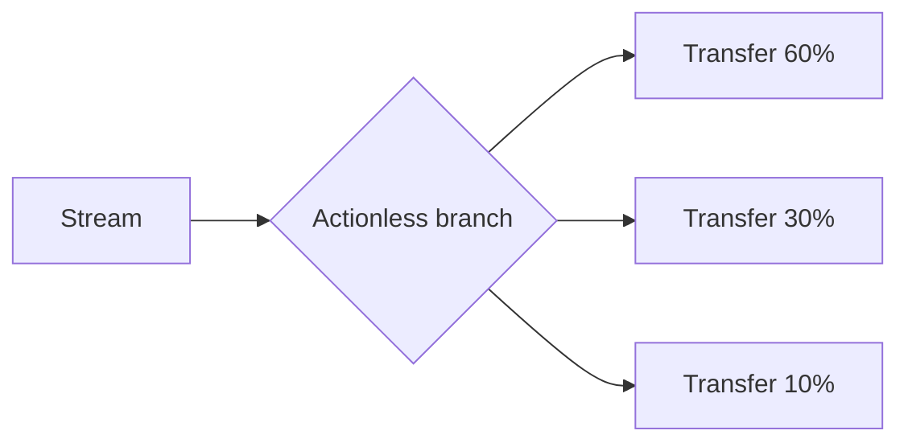

# Payroll

Distribute a streamed allocation among fixed recipients.

Use a [Stream budget](../budgets/stream.md), [Weight Splitter](../splitters/weight.md) and one [Transfer](../actions/transfer.md) [clone](../setup.md) per recipient. The root has no action, so it needs at least two children.

Weights `[600000, 300000, 100000]` divide 1,000 [raw units](../budgets/index.md#core-concepts) into 600, 300 and 100. Fund the `DAO.sol` contract and sync the budget, then let an authorized caller run `plugin.trigger("", new bytes)`. This Solidity expression assumes `plugin` is the installed `CapitalTreePlugin`.

The recipe permits anyone to trigger. It distributes whatever has accrued, not a fixed monthly payment, and resets the stream after success. A failed recipient transfer rolls back all payments. Small allocations can round a child to zero and revert. Restrict timing through permissions if the payroll policy needs a specific execution window.

## Configure and install

Use [`Recipes.payroll`](https://github.com/aragon/capital-tree/blob/47eb5ef56e8f83822d832e23da49dc76b103d37c/script/Recipes.sol) and the [configuration example](https://github.com/aragon/capital-tree/blob/47eb5ef56e8f83822d832e23da49dc76b103d37c/config/payroll.example.json). Follow [setup and permissions](../setup.md#the-install-proposal) to install the flow. Replace addresses and choose amounts in each token's smallest unit.

**Component source:** [StreamBudget.sol](https://github.com/aragon/capital-tree/blob/47eb5ef56e8f83822d832e23da49dc76b103d37c/src/budgets/StreamBudget.sol) · [WeightSplitter.sol](https://github.com/aragon/capital-tree/blob/47eb5ef56e8f83822d832e23da49dc76b103d37c/src/splitters/WeightSplitter.sol) · [TransferAction.sol](https://github.com/aragon/capital-tree/blob/47eb5ef56e8f83822d832e23da49dc76b103d37c/src/actions/TransferAction.sol).

[All examples](./index.md).
