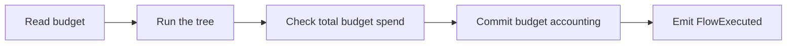

# Execution

A [trigger](concepts.md#a-trigger-runs-the-flow) runs one complete Capital Tree flow. Its caller needs [`TRIGGER_PERMISSION_ID`](setup.md#roles-and-permissions), and the plugin must be unpaused with no trigger already running.

## Who executes the calls

**The `DAO.sol` contract holds the funds and executes the calls.**

When configuring an action, think of its transfers, approvals and other calls as instructions for the `DAO.sol` contract. Actions and budgets return these call descriptions as [`Action[]`](../../core/execution.md). The plugin passes them to `dao.execute()`; the action and budget contracts do not execute those calls themselves.

For example, a vault donation uses the `DAO.sol` contract's tokens and approval. If the vault restricts who may donate, authorize the `DAO.sol` contract: it is the `msg.sender` the vault sees. The same applies to every directly called target. The [trigger caller](concepts.md#a-trigger-runs-the-flow) is supplied separately to components. See [OSx execution](../../core/execution.md#the-execute-function) for how these calls use the contract's authority.

## One transaction



The budget sets the starting token and amount. From node 0, the plugin completes each branch before the next sibling: [build calls, execute through the `DAO.sol` contract, check the result](actions/index.md#building-and-checking-a-node), then pass output to children. An actionless branch passes its input through a splitter.

After checking total spend, the plugin submits the budget's accounting calls. This **commit** restarts a stream or records a claim for the next run. Any failure rolls back the entire transaction, including earlier transfers.

## Inputs and outputs

Each [budget](budgets/index.md) supplies one ERC20 token, but the token and amount in an `Asset` can change downstream: a swap can take USDC as input and produce MYTOKEN as output. Each node works with its assigned amount. This lets a swap's proceeds feed a split, burn or donation without using the treasury's existing output-token balance as the next step's input.

An [`Asset`](https://github.com/aragon/capital-tree/blob/47eb5ef56e8f83822d832e23da49dc76b103d37c/src/lib/types.sol) carries that allocation:

```solidity
struct Asset {
    IERC20 token;
    uint256 amount;
}
```

`Asset.token` can reference any ERC20 contract; USDC is only an example input token. Amounts use the chosen token's smallest units: for example, 1 USDC is `1_000_000`.

A swap may receive more than its declared minimum output. This extra amount is **surplus**. If a swap requires 100 MYTOKEN but receives 110:

- By default, children share 100; the extra 10 stays in the treasury.
- With `forwardSurplus`, children share all 110. A 20/80 split retains 22 and donates 88; pre-existing MYTOKEN is outside that allocation.

Enable forwarding on an action node with children when later steps should use all proceeds. For different tokens, proceeds are the measured output-token increase. For the same token, they are the input plus the net balance change. The balance checks enforce the declared minimum output and maximum input spend; with the same token, only their net effect can be checked.

Leaves declare zero output. A zero input reverts unless that child has `skipWhenEmpty`, which skips its entire subtree. The root cannot be skippable; other failures always revert.

## Tree validation

When composing a recipe, put parents before their children in the node array. Every node must be reachable from node 0, with one parent per child. Actionless branches need at least two children; splitters must support the child count. Components must bind to the same `DAO.sol` contract, and budget-bound actions to this flow's budget.

Before installation, simulate successful and failing triggers with the complete configuration, including the target network's gas limits. Follow the [repository testing instructions](https://github.com/aragon/capital-tree/blob/47eb5ef56e8f83822d832e23da49dc76b103d37c/README.md#develop).

## Trust boundaries

Choose trusted components: they prepare calls using treasury authority. Input/output balance checks do not validate every allowance, destination or other treasury asset; actions must check their intended effects. Budget accounting calls are also trusted.

Calls cannot target the `DAO.sol` contract or plugin. Calls carrying native value need a function selector, but there is no native-spend cap. Built-in recipes use ERC20 tokens.

## Tracking execution

Use `FlowExecuted` to confirm completion, `NodeExecuted` to inspect each node's input, forwarded output and surplus, and `BudgetCommitted` for accounting. The flow event's input is its budget allocation, not actual spend.

Each trigger has an incrementing **nonce** to distinguish runs. The `DAO.sol` contract's `Executed` events record the submitted batches. See the [plugin source](https://github.com/aragon/capital-tree/blob/47eb5ef56e8f83822d832e23da49dc76b103d37c/src/CapitalTreePlugin.sol) for event fields and execution-ID encoding.
